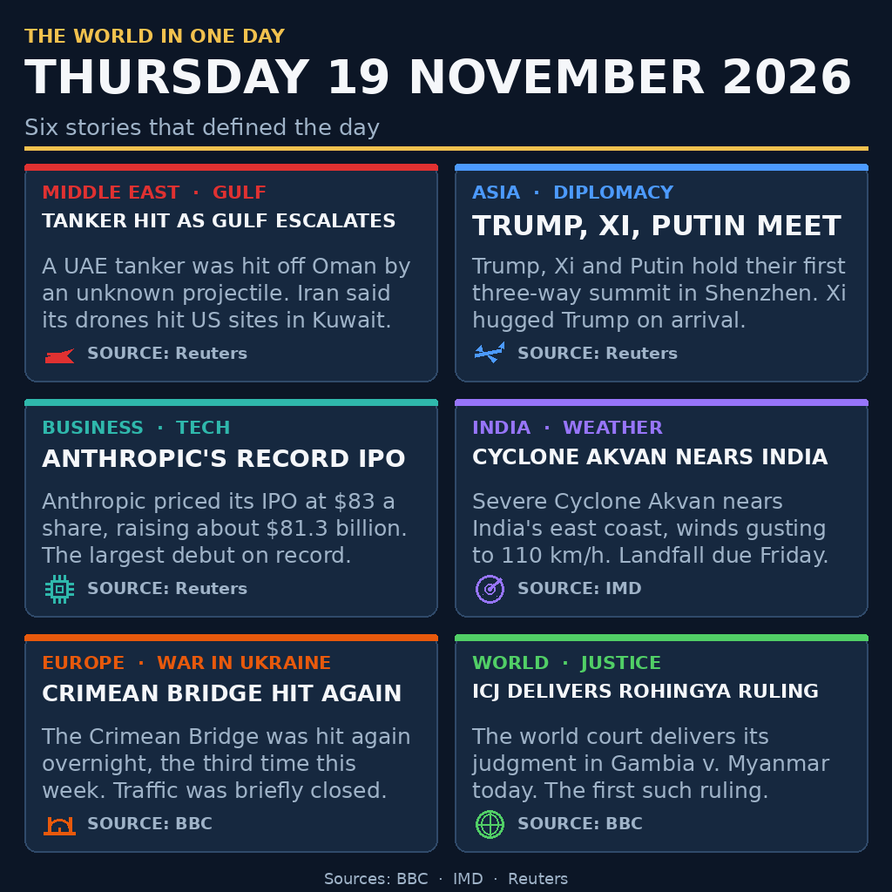

# The World in One Day — Thursday 19 November 2026

One image summing up the world news of **Thursday 19 November 2026**,
built for the [make.fun](https://make.fun) competition
[news-image-20261119](https://make.fun/bounty/news-image-20261119).
An AI judge compares the images two at a time and picks the one that
best sums up the day's news — this is my picture of that day.

- Competition: `news-image-20261119` — free entry, $250 shared by
  the 50 best-ranked images. Entries close 21 November 2026, 07:00 WIB.
- Image: `entry.png`, 1024x1024, 131,489 bytes, drawn from the six
  verified stories below.
- Program: `main.py`, standard library only, no network. Two runs
  write byte-identical output (sha256 `b6568c3c…`).

## The six stories

1. **Tanker hit as Gulf escalates** (Middle East — Reuters). A UAE
   oil tanker was struck off Oman by an unknown projectile, and Iran
   said its drones hit US sites at Ali Al Salem Air Base in Kuwait.
   Commercial transits through the Strait of Hormuz have collapsed to
   about 2 a day, from roughly 85 before the crisis (IMF PortWatch).
2. **Trump, Xi, Putin meet** (Asia — Reuters). The three leaders hold
   their first-ever three-way summit in Shenzhen, on the sidelines of
   the APEC forum. Xi hugged Trump on arrival.
3. **Anthropic's record IPO** (Business — Reuters). Anthropic priced
   its IPO at $83 a share, raising about $81.3 billion — the largest
   stock-market debut on record. Shares start trading on Nasdaq today
   under the ticker ANT.
4. **Cyclone Akvan nears India** (India — IMD). Severe Cyclone Akvan
   sits over the Bay of Bengal with winds gusting to 110 km/h;
   landfall is forecast between Narsapur and Puri by noon on Friday
   20 November.
5. **Crimean Bridge hit again** (Europe — BBC). The bridge linking
   Russia to occupied Crimea was attacked overnight, the third time
   this week. Traffic was briefly closed.
6. **ICJ: Myanmar committed genocide** (World — Reuters). The
   International Court of Justice rules Myanmar committed genocide
   against the Rohingya — the first time the court has ever found a
   state responsible for genocide. The court found Myanmar's forces
   killed around 10,000 Rohingya in the 2017 clearance operations.

Every claim above was checked against live reporting on 19 November
2026 before the image was drawn. Where outlets disagreed, the image
uses the conservative figure and attributes nothing it cannot prove —
the tanker strike is described as an unknown projectile, and the
cyclone landfall as a forecast, not an event.

## How it works

- `entry.png` — the 1024x1024 infographic (the whole entry).
- `main.py` — standard library only. It copies `entry.png` to the
  output directory (`/output/entry.png`, or `$MAKEFUN_OUTPUT_DIR`
  when set), checks the copy is a PNG and byte-identical to the
  original, and fails loudly otherwise. Run it twice and both runs
  write the same bytes.

## License

MIT. See [LICENSE](LICENSE).
